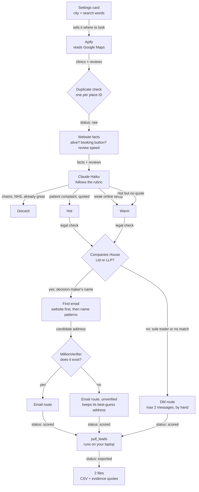

# Lead Engine

Finds UK physio clinics whose own Google reviews prove they miss calls. Built 29 to 31 August 2026 on n8n Cloud, Apify, Claude Haiku, Companies House and MillionVerifier.

## The problem

Small appointment heavy businesses (UK physio clinics in this case) lose bookings when nobody answers the phone. The reason could be busy hours, breaks, off hours.

This engine finds the clinics whose own reviews prove it, so every pitch opens with evidence, not a guess.

## How it works

Two n8n workflows and one script.

- **Workflow A, Harvest.** Reads the settings card, sends Apify to Google Maps, drops duplicates, stores every clinic as raw.
- **Workflow B, Enrich and score.** Checks each website, then Claude Haiku reads the reviews against a written rubric. Hot needs a verbatim patient quote about phones or booking. No quote, no Hot: it drops to Warm automatically.
- **The legal gate.** UK law (PECR) treats a sole trader like a private person, so no cold email without consent. Only a Ltd or LLP found on Companies House goes to the email route. Everything else gets a DM, by hand.
- **pull_leads.** Exports the shortlist to a CSV plus an evidence file with the quotes behind every lead.

## Results: Manchester, August 2026

| Step | Clinics |
|---|---|
| Collected by Apify | 386 |
| Left after duplicates and filters | 318 |
| Discarded | 242 |
| Failed to score | 18 |
| **Hot** | **4** |
| **Warm** | **54** |
| Email route (legally emailable) | 21 |
| Email route with a verified address | 7 |
| DM route | 37 |

Apify spend for all three runs, tests included: $4.97.

The evidence quotes stay private. They are real patients' words about named clinics.

## Mistakes

**Apify cost bug.** Two mistakes, back to back. First Manchester run: the cap applied to EACH of my 4 search terms, so 4 x 10 = 40. Cost $0.53. I switched to a total cap of 20. The next run ignored it and pulled 346 clinics. Cost $4.39. All three runs came to $4.97 and used up my free Apify credit. I still don't know why the total cap didn't hold, so harvesting stays paused until it does.

**NHS leak.** First test batch: 50 clinics in, 2 came out Hot. Both were NHS GP surgeries. Their patients DO complain about phones, so the AI was right about the problem and wrong about the buyer. A GP surgery is not a physio clinic and will never buy from me. Fix: rubric v1.1 and the skip list now throw out anything named Surgery, Health Centre or Medical Practice.

**18 silent failures.** 18 of 318 Manchester clinics came back as ERROR. The engine never scored them and never wrote down why. I paid Apify to collect those 18 and then lost them blind. Next fix: every failure records its reason.

**The email bottleneck.** 58 clinics made the shortlist. 37 were sole traders or had no company match, so the law says DM, not email. Of the 21 I could legally email, only 7 had an address MillionVerifier confirmed. 7 out of 58. The scoring works. Finding a real inbox is the weak link.

## Run it yourself

1. Import both files in `workflows/` into n8n.
2. Create the credentials they ask for: Apify, Anthropic, Companies House, MillionVerifier.
3. Create two n8n Data Tables (config and leads) and put their IDs where the workflows say `YOUR_..._TABLE_ID`.
4. Copy `.env.example` to `.env` and fill it in. `.env` never gets committed.
5. Run Workflow A, then Workflow B, then `node scripts/pull_leads.mjs`.

Fix the Apify cap first. See Mistakes.
